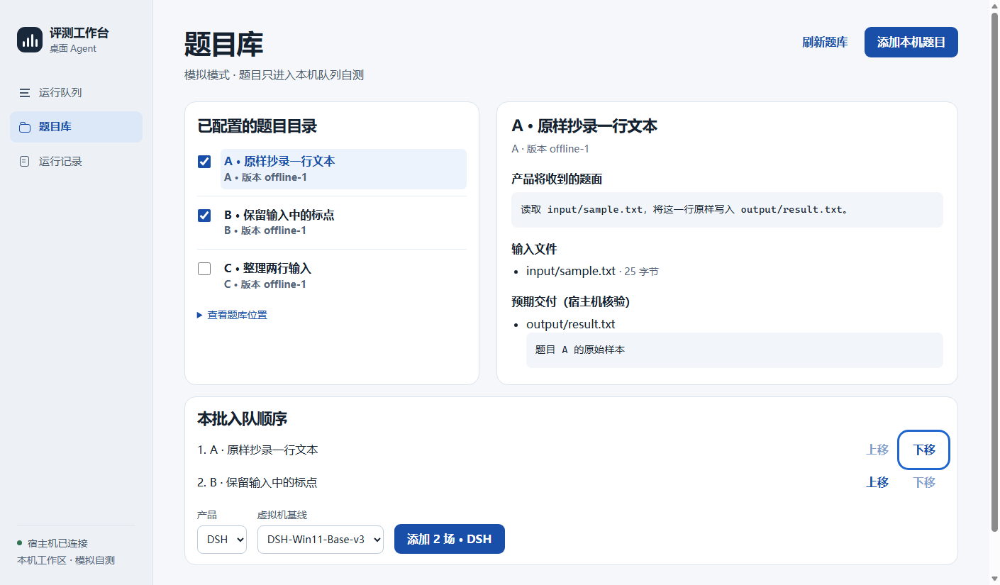
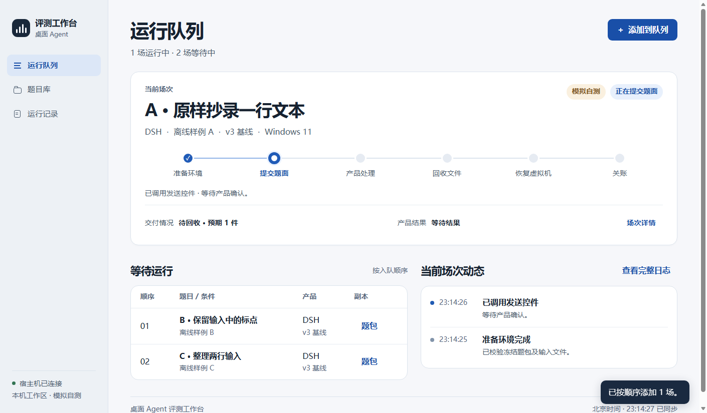
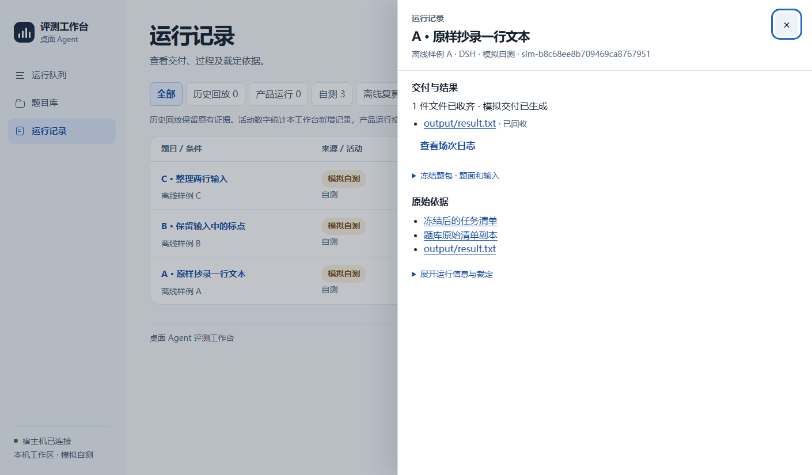

# DSH 桌面评测工作台

工作台通过本机网页管理 DeepSeek Harness（DSH）的评测任务。题目入队时会保存题面和输入副本。同一时刻运行一场，后面的场次等前一场关账再启动。运行记录可以打开场次日志、回收文件和原始回执。

## 功能截图

以下画面来自模拟模式，用来展示界面和队列操作。实际 DSH 的一次完整运行另有可核对的脱敏证据。[Windows 最小真实任务验收](../../evidence/windows-issue3-minimal-2026-11-22/README.md)

**题目库。** 预览题面、输入和交付要求，勾选后调整这一批的顺序。

**运行队列。** 当前场次显示进度，待运行列表保留排队顺序。运行期间仍可以追加题目。

**运行记录。** 打开场次详情可以看到已回收的文件、场次日志和题包。

## 先用模拟模式熟悉流程

从仓库根目录执行。需要 Python 3.10 或更新版本。

~~~powershell
python -B -X utf8 tools/windows-workbench/workbench.py
~~~

打开 [本机工作台](http://127.0.0.1:8765/#library)，勾选 A「原样抄录一行文本」、B「保留输入中的标点」，调整顺序后入队。样例结果由模拟后台生成，记录计入「自测」。服务和页面都使用本机地址。模拟数据默认保存到工作台目录下的 `.data/simulation`。

## 使用真实 DSH 模式

需要已配置的 Windows 宿主机、Hyper-V 虚拟机、登记基线和来宾凭据，以及宿主机的运行账本。安装、配置和控制目录见 [Windows 单题运行器](../windows-single-task/README.md)。

按现有入口的配置，评分侧清单通过宿主机的 `E$` 共享做拒读预检，因此工作台的真实模式数据目录要放在宿主机 E 盘。从仓库根目录启动：

~~~powershell
python -B -X utf8 tools/windows-workbench/workbench.py --mode dsh --port 8766 --state-dir E:/Harness-Eval/Workbench --library tools/windows-workbench/真实示例题库
~~~

打开 [真实题目库](http://127.0.0.1:8766/#library)，页面会显示「DSH 正式模式」。示例题库包含「库存汇总与外部评分文件拒读」和「提取待发货订单」。也可以点「添加本机题目」，选择一个含 `task.json` 和声明输入文件的目录。

勾选题目、确认顺序和基线后，点击「真实运行」。当前场次结束并通过归档、恢复及关账核对后，下一场会接续启动。发送或清理状态未核实时，队列会保留原请求和已取得的证据，便于继续核对。公开版的真实入口覆盖标准单题。ART04「三文件修订与多轮交付」页脚专项批次使用其配套运行环境。

## 离线自测

在 Windows 上安装 Node.js 22 或更新版本及 Edge，从仓库根目录执行：

~~~powershell
node tools/windows-workbench/acceptance.mjs
~~~

自测在独立的本机端口和目录中启动模拟后台与 Edge，核对入队排序、重复请求、运行时追加、后台重启后续接、异常暂停和交付记录。报告和截图保存在 `.data/acceptance/`。若 Edge 或 Python 位于其他位置，可用 `WORKBENCH_EDGE` 或 `WORKBENCH_PYTHON` 指定可执行文件路径。
